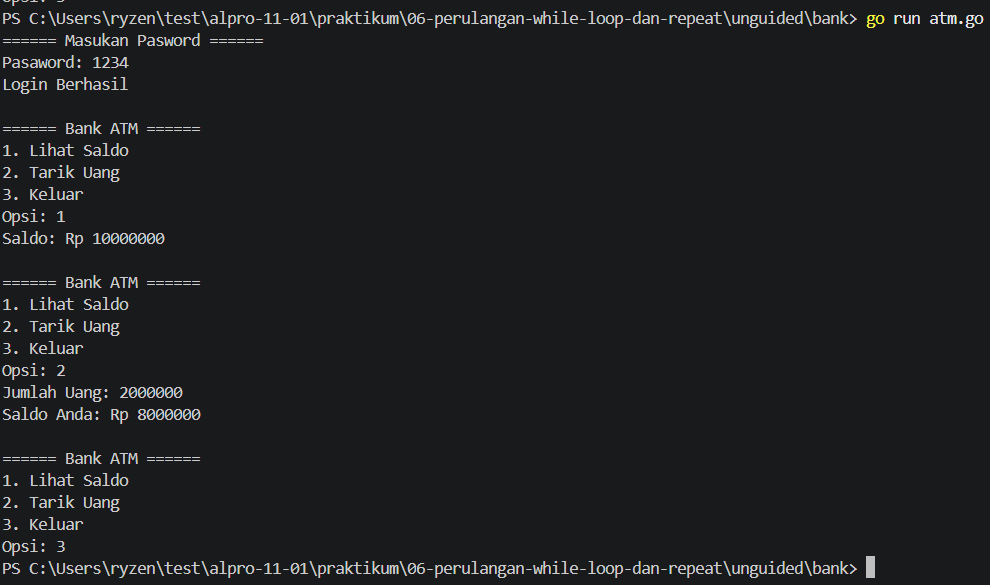

# <h1 align="center">Laporan Praktikum Modul 06-Perulangan-While-Loop-dan-Repeat</h1>
<p align="center">Reihan - 109092600002</p>

## Dasar Teori

### A. While Loop
Di dalam go tidak ada `while` namun kita bisa menggunakan `for(kondisi)` untuk melakukan while loop di dalam golang.

### B. Kondisi Berhenti dan Penelusuran String
Perulangan while biasanya dihentikan lewat nilai tertentu, batas percobaan, atau pilihan keluar di menu. Kalau datanya string, tiap karakter bisa dicek pakai indeks `kalimat[i]`, dan panjangnya didapat dari `len(kalimat)`

<!-- Tambahkan poin A, B, C, ... atau sub-topik 1, 2, 3, ... sesuai kebutuhan modul -->

## Guided

### 1. terkecil.go

```go
package main

import "fmt"

func main() {
    var batas int
    fmt.Scan(&batas)

    n := 1
    for n*n*n <= batas {
        n++
    }

    fmt.Println(n)
}
```

#### Deskripsi
Kode Go tersebut bertujuan untuk mencari nilai $n$ terkecil sedemikian sehingga $n^3 > \text{batas}$ (atau dengan kata lain, $n$ adalah bilangan bulat terkecil yang kubiknya melebihi batas).

### 2. terbesar.go

```go
package main

import "fmt"

func main() {
    var batas int
    fmt.Scan(&batas)

    n := 1
    for n*n < batas {
        n++
    }

    fmt.Println(n - 1)
}
```

#### Deskripsi
Program tersebut adalah program sederhana untuk mencari akar kuadrat bulat ke bawah dari suatu angka yang diinputkan oleh pengguna (batas).


### 3. Vokal
```go
package main

import (
    "bufio"
    "fmt"
    "os"
    "strings"
)

func main() {
    reader := bufio.NewReader(os.Stdin)
    kalimat, _ := reader.ReadString('\n')

    i := 0
    jumlahVokal := 0

    for i < len(kalimat) {
        ch := strings.ToLower(string(kalimat[i]))
        if ch == "a" || ch == "i" || ch == "u" || ch == "e" || ch == "o" {
            jumlahVokal++
        }
        i++
    }

    fmt.Println(jumlahVokal)
}
```

#### Deskripsi
Kode di atas berfungsi untuk mengecek apakah di dalam suatu kalimat apakah ada huruf vokal `a, i, u, e, o` dan menghitung jumlah huruf vokal nya

## Unguided
### 1. Buatlah program dalam bahasa Go untuk menampilkan seluruh faktor dari sebuah bilangan bulat positif n, kemudian menentukan apakah n merupakan bilangan prima atau bukan
```go
package main

import "fmt"

func main(){
	var opsi int
	var done bool = false
	pw := 1234
	uang := 10000000
	try := 3
	

	fmt.Println("====== Masukan Pasword ======")

	//loop utama
	for {
		if done {
			break
		}
		ins_pw := 0000
		fmt.Print("Pasaword: ")
		fmt.Scan(&ins_pw)

		//jika pw salah
		if ins_pw != pw {
			fmt.Println("Pasword yang anda masukan salah")
			try = try - 1
			
			//jika jumlah percobaan mencapai max
			if try == 0{
				fmt.Println("Maaf ATM Anda Terkunci")
				break
			}

			//jika atm berhasil
		} else {
			fmt.Println("Login Berhasil")

			//loop jika berhasil
			for {
				opsi = 0
				tarik := 0
				fmt.Println("\n====== Bank ATM ======")
				fmt.Println("1. Lihat Saldo")
				fmt.Println("2. Tarik Uang")
				fmt.Println("3. Keluar")
				fmt.Print("Opsi: ")
				fmt.Scan(&opsi)

				//opsi 1
				if opsi == 1 {
					fmt.Println("Saldo: Rp", uang)

				//opsi 2
				} else if opsi == 2 {
					fmt.Print("Jumlah Uang: ")
					fmt.Scan(&tarik)
					if tarik > uang {
						fmt.Println("Saldo anda tidak mencukupi")
					} else if tarik <= 0 {
						fmt.Println("Jumlah Tidak Valid")
					} else {
						uang = uang - tarik
						fmt.Println("Saldo Anda: Rp",uang)
					}
				
				//opsi 3
				} else if opsi == 3{
					done = true
					break

				//opsi lain nya
				} else {
					fmt.Println("Opsi tidak valid")
				}
			}
		}
	}
}
```
##### Output


#### Deskripsi
Program ini adalah simulasi mesin Anjungan Tunai Mandiri (ATM). Program ini mensimulasikan proses autentikasi pengguna melalui password, pembatasan jumlah percobaan login yang salah (keamanan akun terkunci), serta menu transaksi perbankan dasar seperti pengecekan saldo dan penarikan tunai.

## Referensi
1. The Go Authors. (2024). The Go Programming Language Specification. Diakses melalui https://go.dev/ref/spec
<!-- Tambahkan nomor referensi berikutnya sesuai kebutuhan -->
