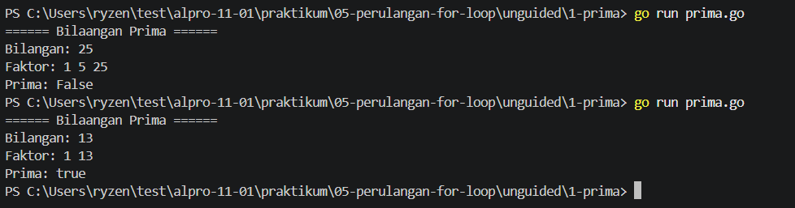

# <h1 align="center">Laporan Praktikum Modul 06-Perulangan-While-Loop-dan-Repeat</h1>
<p align="center">Reihan - 109092600002</p>

## Dasar Teori

### A. Loop Di Dalam Go
Go hanya memiliki `for` loop yang berarti Go tidak memiliki `while` loop seperti bahasa pemrograman C++. Tidak seperti bahasa lain seperti C, Java, atau JavaScript, tidak ada tanda kurung yang mengapit ketiga komponen pernyataan tersebut fordan tanda kurung kurawal `{ }` selalu diperlukan. Loop Dalam Bahasa Go memiliki tiga komponen penting.
#### 1. **Inisialisasi**
adalah komponen yang di eksekusi sekali sebelum perulangan. Berfungsi untuk menghitung dan mengatur perulangan.
#### 2. **Kondisi**
adalah ekspresi boolean yang dievaluasi sebelum setiap perulangan dimulai. Berfungsi untuk menentukan apakah perulangan harus di lanjutkan atau di hentikan.
#### 3. **Post statment**
adalah pernyataan yang dieksekusi di akhir setiap iterasi. Berfungsi untuk mengubah suatu variabel dan menampilkan output.

<!-- Tambahkan poin A, B, C, ... atau sub-topik 1, 2, 3, ... sesuai kebutuhan modul -->

## Guided

### 1. terkecil.go

```go
package main

import "fmt"

func main() {
    var batas int
    fmt.Scan(&batas)

    n := 1
    for n*n*n <= batas {
        n++
    }

    fmt.Println(n)
}
```

#### Deskripsi
Kode Go tersebut bertujuan untuk mencari nilai $n$ terkecil sedemikian sehingga $n^3 > \text{batas}$ (atau dengan kata lain, $n$ adalah bilangan bulat terkecil yang kubiknya melebihi batas).

### 2. terbesar.go

```go
package main

import "fmt"

func main() {
    var batas int
    fmt.Scan(&batas)

    n := 1
    for n*n < batas {
        n++
    }

    fmt.Println(n - 1)
}
```

#### Deskripsi
Program tersebut adalah program sederhana untuk mencari akar kuadrat bulat ke bawah dari suatu angka yang diinputkan oleh pengguna (batas).


### 3. Vokal
```go
package main

import (
    "bufio"
    "fmt"
    "os"
    "strings"
)

func main() {
    reader := bufio.NewReader(os.Stdin)
    kalimat, _ := reader.ReadString('\n')

    i := 0
    jumlahVokal := 0

    for i < len(kalimat) {
        ch := strings.ToLower(string(kalimat[i]))
        if ch == "a" || ch == "i" || ch == "u" || ch == "e" || ch == "o" {
            jumlahVokal++
        }
        i++
    }

    fmt.Println(jumlahVokal)
}
```

#### Deskripsi
Kode di atas berfungsi untuk mengecek apakah di dalam suatu kalimat apakah ada huruf vokal `a, i, u, e, o` dan menghitung jumlah huruf vokal nya

## Unguided
### 1. Buatlah program dalam bahasa Go untuk menampilkan seluruh faktor dari sebuah bilangan bulat positif n, kemudian menentukan apakah n merupakan bilangan prima atau bukan
```go
package main

import "fmt"

func main(){
	var opsi int
	var done bool = false
	pw := 1234
	uang := 10000000
	try := 3
	

	fmt.Println("====== Masukan Pasword ======")

	//loop utama
	for {
		if done {
			break
		}
		ins_pw := 0000
		fmt.Print("Pasaword: ")
		fmt.Scan(&ins_pw)

		//jika pw salah
		if ins_pw != pw {
			fmt.Println("Pasword yang anda masukan salah")
			try = try - 1
			
			//jika jumlah percobaan mencapai max
			if try == 0{
				fmt.Println("Maaf ATM Anda Terkunci")
				break
			}

			//jika atm berhasil
		} else {
			fmt.Println("Login Berhasil")

			//loop jika berhasil
			for {
				opsi = 0
				tarik := 0
				fmt.Println("\n====== Bank ATM ======")
				fmt.Println("1. Lihat Saldo")
				fmt.Println("2. Tarik Uang")
				fmt.Println("3. Keluar")
				fmt.Print("Opsi: ")
				fmt.Scan(&opsi)

				//opsi 1
				if opsi == 1 {
					fmt.Println("Saldo: Rp", uang)

				//opsi 2
				} else if opsi == 2 {
					fmt.Print("Jumlah Uang: ")
					fmt.Scan(&tarik)
					if tarik > uang {
						fmt.Println("Saldo anda tidak mencukupi")
					} else if tarik <= 0 {
						fmt.Println("Jumlah Tidak Valid")
					} else {
						uang = uang - tarik
						fmt.Println("Saldo Anda: Rp",uang)
					}
				
				//opsi 3
				} else if opsi == 3{
					done = true
					break

				//opsi lain nya
				} else {
					fmt.Println("Opsi tidak valid")
				}
			}
		}
	}
}
```
##### Output


#### Deskripsi
Kode di atas berfungsi untuk menampilkan berapa banyak bilangan yang bisa di bagi dengan bilangan yang telah kita masukan. jika bilangan yang di masukan hanya bisa di bagi oleh dua bilangan berarti bilangan prima. Jika tidak maka bukan bilangan prima.

## Referensi
1. *A Tour Of Go*. Diakses pada 18 Oktober 2026 melalui https://go.dev/tour/flowcontrol/1
2. *GitHub*. Diakses pada 18 Oktober 2026 melalui https://github.com/Hanz145/alpro-11-01/blob/main/praktikum/05-perulangan-for-loop/tp/Soal-No1/fungsi-utama-struktur-for.md
<!-- Tambahkan nomor referensi berikutnya sesuai kebutuhan -->
