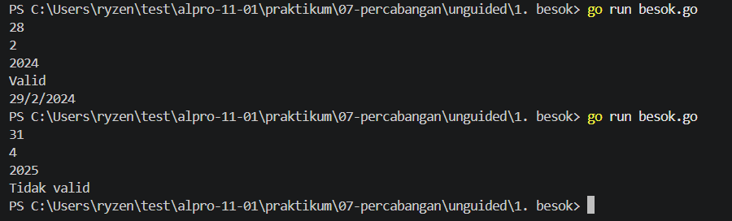
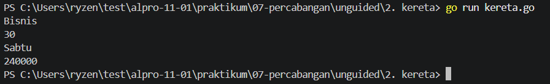

# <h1 align="center">Laporan Praktikum Modul 07-Percabangan</h1>
<p align="center">Reihan - 109092600002</p>

## Dasar Teori

### A. Percabangan if else
Penggunaan `else` dan `else if`:
Digunakan untuk menangani banyak kondisi bercabang secara berurutan dari atas ke bawah.
### B. Percabangan Swwitch Case
Sama seperti `if-else`, switch-case adalah struktur kontrol percabangan yang digunakan untuk mengontrol alur eksekusi program berdasarkan kondisi tertentu. Namun, switch-case jauh lebih bersih, rapi, dan mudah dibaca ketika Anda dihadapkan pada banyak pilihan nilai atau kondisi.
<!-- Tambahkan poin A, B, C, ... atau sub-topik 1, 2, 3, ... sesuai kebutuhan modul -->

## Guided

### 1. kabisat.go
```go
package main

import "fmt"

func main() {
    var tahun int
	fmt.Scan(&tahun)

	if (tahun % 4 == 0 && tahun % 100 != 0) || (tahun % 400 == 0) {
		fmt.Print(tahun, " masehi merupakan tahun kabisat")
	} else {
		fmt.Print(tahun, " masehi bukanlah tahun kabisat")
	}

}
```

#### Deskripsi
Kode Go tersebut berfungsi untuk mencari tahu apakah tahun yang di input adalah tahun kabisat. caranya memngecek tahun yang di masukan lalu di modulkan. apabika `tahun MOD 4 dan tahun tidak samadengan 100 atau tahun MOD 400 sama dengan 0` maka terbilang tahun kabisat

### 2. segitiga.go

```go
package main

import "fmt"

func main (){
	var a, t, m int // a untuk alas, t sisi 1, m untuk sisi 2
	fmt.Println("====== Segitiga ======")
	fmt.Print("Alas: ")
	fmt.Scan(&a)
	fmt.Print("Sisi_Satu: ")
	fmt.Scan(&t)
	fmt.Print("Sisi_Dua: ")
	fmt.Scan(&m)

	//percabangan
	if (a + t > m) && (t + m > a) && (m + a > t) && ((a > 0) && (t > 0) && (m > 0)){
		fmt.Println("Segitiga Valid")
		if (a == t) && (t != m) || (t == m) && (m != a) || (m == a) && (a != t){
			fmt.Print("Segitiga Sama Kaki")
		} else if (a*a + t*t == m*m) || (a*a + m*m == t*t) {
			fmt.Print("Segitiga Siku-Siku")
		} else if (a == t) && (t == m) {
			fmt.Print("Segitiga Sama Sisi")
		} else {
			fmt.Print("Segitiga Sembarangan")
		}
	} else {
		fmt.Printf("Segitiga Tidak Valid")
	}
}
```

#### Deskripsi
Program tersebut adalah program sederhana untuk mencari apakah sisi yang dimasukan adalah segitiga atau bukan, lalu mengidentifikasi swgitiga tersebut.


### 3. kalkulator.go
```go
package main

import "fmt"

func main (){
	var a, b int
	var op string
	
fmt.Scan(&a, &op, &b)

switch op {
case "+":
	fmt.Println(a + b)
case "-":
	fmt.Println(a-b)
case "*":
	fmt.Println(a*b)
case "/":
	if b == 0{
		fmt.Println("error, b != 0")
	} else {
		fmt.Println("%.2f\n", float64(a)/float64(b))
	}
case "%":
	if b == 0{
		fmt.Println("error, b != 0")
	} else {
		fmt.Println(a % b)
	}
}
}
```

#### Deskripsi
Kode di atas berfungsi untuk sebagai kalkulator sederhana menggunakan percabangan switch case dan if else.

### 4. ongkir.go
```go
package main

import (
	"fmt"
	"math"
)

func main(){
	var berat float64
	var zona int
	var layanan string

	fmt.Scan(&berat, &zona, &layanan)

	if berat > 30{
		fmt.Println("Berat melebihi batas max (30kg)")
		return
	}

	var tarifperkg int

	switch zona{
		case 1:
			tarifperkg = 10000
		case 2:
			tarifperkg = 15000
		case 3:
			tarifperkg = 25000
		default :
			fmt.Println("zona tidak valid")
			return
	}

	beratbulat := int(math.Ceil(berat))
	total := beratbulat * (tarifperkg)

	if layanan == "Express"{
		total = total + total / 2
	} else if layanan != "Reguler"{
		fmt.Println("Layanan tidak valid")
		return
	}

	fmt.Println(beratbulat)
	fmt.Println(total)
}
```

#### Deskripsi
Kode di atas berfungsi untuk menentukan harga ongkir sesuai kriteria barang yang di pesan.

## Unguided
### 1.  Buatlah program dalam bahasa Go yang menerima input tanggal, bulan, dan tahun, kemudian memeriksa apakah tanggal tersebut valid.
```go
package main
import "fmt"
func main() {
	var tanggal, bulan, tahun int
	fmt.Scan(&tanggal, &bulan, &tahun)

	kabisat := (tahun%4 == 0 && tahun%100 != 0) || tahun%400 == 0

	hariBulan := 0
	switch bulan {
	case 1, 3, 5, 7, 8, 10, 12:
		hariBulan = 31
	case 4, 6, 9, 11:
		hariBulan = 30
	case 2:
		if kabisat {
			hariBulan = 29
		} else {
			hariBulan = 28
		}
	}

	if tanggal < 1 || tanggal > hariBulan {
		fmt.Println("Tidak valid")
		return
	}

	tanggal++
	if tanggal > hariBulan {
		tanggal = 1
		bulan++
		if bulan > 12 {
			bulan = 1
			tahun++
		}
	}

	fmt.Println("Valid")
	fmt.Printf("%d/%d/%d\n", tanggal, bulan, tahun)
}
```
##### Output


#### Deskripsi
Program ini adalah berfungsi untuk mengecek apakah tanggal yang dimasukan adalah vallid atau tidak

### 2.  Buatlah program untuk menghitung harga tiket kereta berdasarkan kelas, usia penumpang, dan hari keberangkatan.
```go
package main

import "fmt"

func main() {
	var kelas, hari string
	var usia int
	fmt.Scan(&kelas, &usia, &hari)

	harga := 0
	switch kelas {
	case "Ekonomi":
		harga = 100000
	case "Bisnis":
		harga = 200000
	case "Eksekutif":
		harga = 350000
	default:
		fmt.Println("Kelas tidak valid")
		return
	}

	if hari == "Sabtu" || hari == "Minggu" {
		harga = harga * 120 / 100
	}

	if usia < 3 {
		harga = 0
	} else if usia <= 12 {
		harga = harga * 50 / 100
	} else if usia >= 60 {
		harga = harga * 70 / 100
	}

	fmt.Println(harga)
}
```
##### Output


#### Deskripsi
Program ini berfungsi untuk memberikan harga tiket sesuai kriteria yang di inginkan penumpang.

## Referensi
1. The Go Authors. (2024). The Go Programming Language Specification. Diakses melalui https://go.dev/ref/spec
<!-- Tambahkan nomor referensi berikutnya sesuai kebutuhan -->
