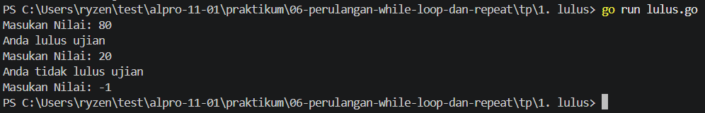
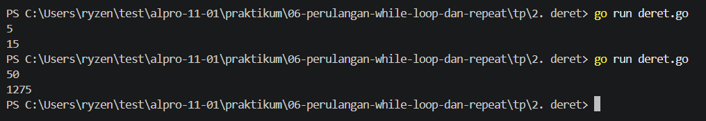
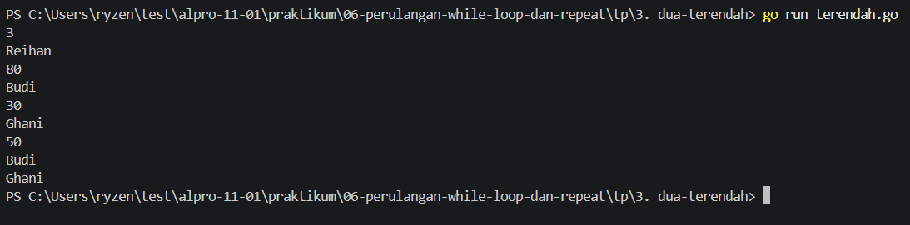

# <h1 align="center">Tugas Pendahuluan Modul 06 - Perulangan-While-Loop-dan-Repeat</h1>
<p align="center">Reihan - 109092600002</p>

### 1. bilangan.go
```go
package main
import "fmt"
func main() {
	var n int
	fmt.Scan(&n)

	if n == 0 {
		fmt.Println("Nol")
	} else {
		var jenis, status string

		if n%2 == 0 {
			jenis = "Genap"
		} else {
			jenis = "Ganjil"
		}

		if n > 0 {
			status = "Positif"
		} else {
			status = "Negatif"
		}

		fmt.Println(jenis + ", " + status)
	}
}
```

##### Output
<!-- Path relatif dari readme.md ke folder unguided/[nama_soal]/output.png, contoh: -->



#### Deskripsi
Menentukan apakah mahasiswa lulus atau tidak dan menghitung berapa banyak mahasiswa yang lulus sesuai banyak nya mahasiswa yang di masukan.

### 2. hari.go
```go
package main
import "fmt"
func main() {
	var hari int
	fmt.Scan(&hari)

	switch hari {
	case 1:
		fmt.Println("Senin")
	case 2:
		fmt.Println("Selasa")
	case 3:
		fmt.Println("Rabu")
	case 4:
		fmt.Println("Kamis")
	case 5:
		fmt.Println("Jumat")
	case 6:
		fmt.Println("Sabtu")
	case 7:
		fmt.Println("Minggu")
	default:
		fmt.Println("Hari tidak valid")
	}
}
```

##### Output
<!-- Path relatif dari readme.md ke folder unguided/[nama_soal]/output.png, contoh: -->



#### Deskripsi
Menambahkan bilangan dari `1` sampai `n` (bilangan yang di input)

### 3. terbesar.go
```go
package main
import "fmt"
func main() {
	var a, b, c, max int
	fmt.Scan(&a, &b, &c)

	if a >= b && a >= c {
		max = a
	} else if b >= a && b >= c {
		max = b
	} else {
		max = c
	}

	fmt.Println(max)
}
```

##### Output
<!-- Path relatif dari readme.md ke folder unguided/[nama_soal]/output.png, contoh: -->



#### Deskripsi
Program di atas membantu mencari dua mahasiswa dengan nilai terendah dari banyak nya mahasiswa yang di input.

## Kesimpulan
Tujuan tugas pendahuluan minggu ini yaitu supaya mahasiswa yahu cara menggunakan perulangan while loop dan repeat until.