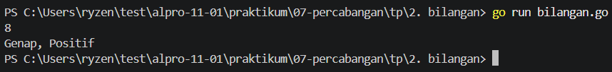
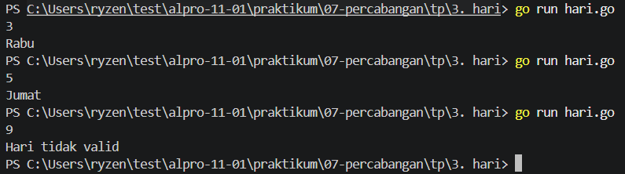
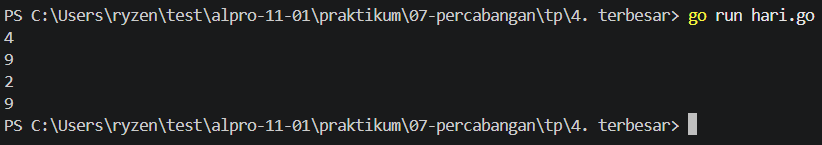

# <h1 align="center">Tugas Pendahuluan Modul 07 - Percabangan</h1>
<p align="center">Reihan - 109092600002</p>

### 1. bilangan.go
```go
package main
import "fmt"
func main() {
	var n int
	fmt.Scan(&n)

	if n == 0 {
		fmt.Println("Nol")
	} else {
		var jenis, status string

		if n%2 == 0 {
			jenis = "Genap"
		} else {
			jenis = "Ganjil"
		}

		if n > 0 {
			status = "Positif"
		} else {
			status = "Negatif"
		}

		fmt.Println(jenis + ", " + status)
	}
}
```

##### Output
<!-- Path relatif dari readme.md ke folder unguided/[nama_soal]/output.png, contoh: -->



#### Deskripsi
Program di atas menentukan bilangan (genap/ganjil) dan positif atau negatif. Angka 0 dicek di awal dan dicetak "Nol". Untuk angka lain, `n mod 2 = 0` menentukan genap atau ganjil, dan `n > 0` menentukan apakah biangan positif atau negatif.

### 2. hari.go
```go
package main
import "fmt"
func main() {
	var hari int
	fmt.Scan(&hari)

	switch hari {
	case 1:
		fmt.Println("Senin")
	case 2:
		fmt.Println("Selasa")
	case 3:
		fmt.Println("Rabu")
	case 4:
		fmt.Println("Kamis")
	case 5:
		fmt.Println("Jumat")
	case 6:
		fmt.Println("Sabtu")
	case 7:
		fmt.Println("Minggu")
	default:
		fmt.Println("Hari tidak valid")
	}
}
```

##### Output
<!-- Path relatif dari readme.md ke folder unguided/[nama_soal]/output.png, contoh: -->



#### Deskripsi
Program di atas mengubah hari (1 sampai 7) menjadi nama hari memakai `case switch`. Nomor selain itu masuk ke default dan mencetak "Hari tidak valid".

### 3. terbesar.go
```go
package main
import "fmt"
func main() {
	var a, b, c, max int
	fmt.Scan(&a, &b, &c)

	if a >= b && a >= c {
		max = a
	} else if b >= a && b >= c {
		max = b
	} else {
		max = c
	}

	fmt.Println(max)
}
```

##### Output
<!-- Path relatif dari readme.md ke folder unguided/[nama_soal]/output.png, contoh: -->



#### Deskripsi
Program di atas mencari bilangan terbesar dari tiga bilangan menggunakan if - else if - else. Tanda >= dipakai supaya kasus ada dua bilangan tertinggi yang sama tetap benar.

## Kesimpulan
Percabangan dipakai supaya program bisa memilih jalur sesuai kondisi. if - else if cocok untuk kondisi berupa perbandingan atau rentang, sedangkan switch lebih rapi kalau yang dicek adalah nilai tertentu seperti nomor hari. Di Go, switch tidak butuh break karena otomatis berhenti setelah satu case cocok.